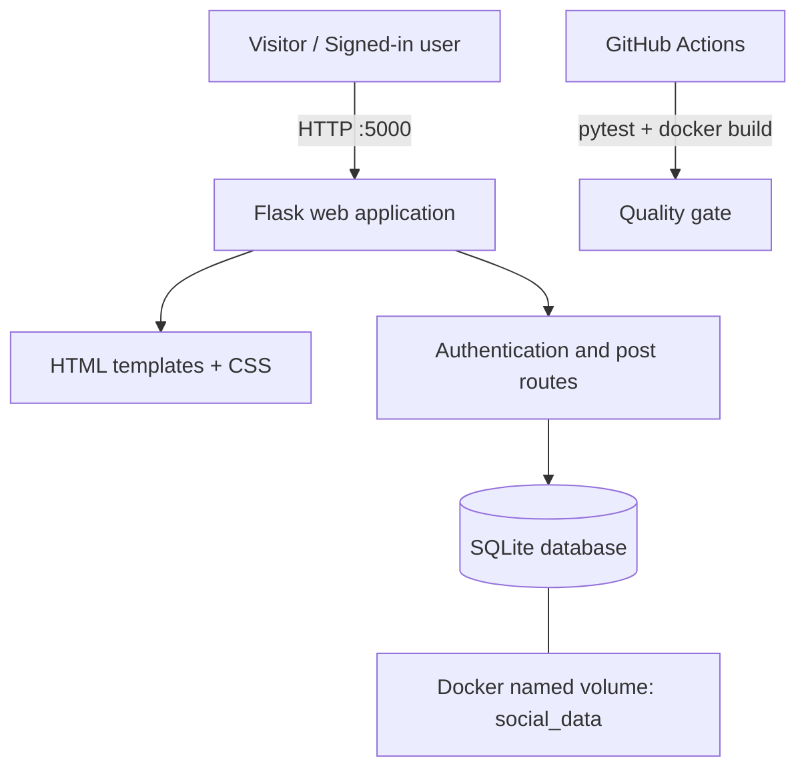

# Architecture

## Style
A small **monolithic web application**. Flask handles HTTP routes, validation, authentication/session logic and HTML rendering. SQLite stores users and posts. Docker packages the application; Compose mounts a named volume for persistence.

## Diagram

## Main components
- **Presentation:** Jinja templates and responsive CSS.
- **Application:** registration, login/logout, feed, post creation and health routes.
- **Persistence:** SQLite tables `users` and `posts`; foreign key links each post to its author.
- **Runtime:** Gunicorn serves Flask in the container; Compose maps host port 5000 and mounts `/data`.
- **Quality automation:** GitHub Actions installs test dependencies, runs pytest and builds the container image.

## Data model
- `users(id, username UNIQUE, password_hash, created_at)`
- `posts(id, user_id FK → users.id, content, created_at)`
- Index on `posts(created_at DESC, id DESC)` supports newest-first feed ordering.

## Request flow: publishing
1. User submits the post form.
2. The route verifies an authenticated session.
3. The content is trimmed and checked for 1–280 characters.
4. The post is inserted with the authenticated user's ID and UTC timestamp.
5. The browser redirects to the feed, which queries newest-first records.

## Trade-offs
A monolith minimizes setup and operational overhead for a small MVP. SQLite is easy to run locally and appropriate for a single app instance, but it is not the best fit for horizontal scaling or high concurrent write volume. A PostgreSQL migration and external session store would be reasonable next steps for a multi-instance deployment.
